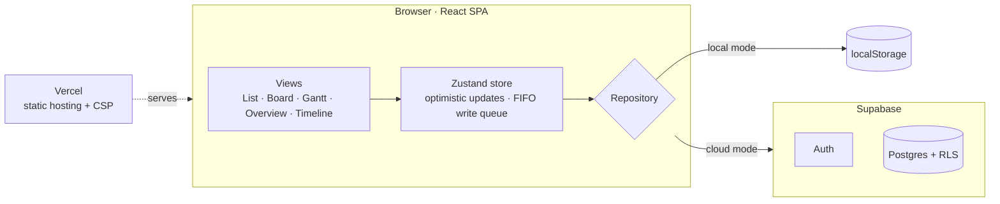

<p align="center">
  
</p>

<h1 align="center">Cairn</h1>

<p align="center">
  <strong>Plan clearly. Work simply.</strong><br>
  A calm, keyboard-friendly workspace for personal projects, tasks and timelines.
</p>

---

## Overview

Cairn is a personal project manager. One set of projects and tasks can be viewed as a list, a board
or a Gantt chart, with an overview, a personal task inbox and a cross-project timeline on top.

It exists because the usual choices sit at two extremes. Simple to-do apps have no sense of phases,
dates or dependencies, so a project with a real schedule outgrows them quickly. Team tools have all
of that, but they bring workspaces, permissions, notifications and setup that one person does not
need. Cairn keeps the planning features (phases, milestones, dependencies, scheduling) and leaves
out the collaboration machinery.

It is built for one owner who plans several long-running projects at once: side projects, studies,
renovations, anything with tasks that have dates and an order. It is desktop-first, works fully from
the keyboard, and handles Chinese input (IME) correctly in every text field.

## Features

**Projects and tasks**

- Projects with optional phases, tasks with one level of subtasks, and dated milestones
- Status, priority, start and due dates, descriptions, and progress that rolls up from subtasks
- A task panel that saves every field automatically, with drafts kept safe across navigation and
  IME composition

**Views**

- **List**: tasks grouped by phase, with inline editing and drag-and-drop ordering
- **Board**: a Kanban board by status, with drag-and-drop between columns
- **Gantt**: drag and resize bars, draw dependencies, Day / Week / Month scales, milestones and
  weekend shading
- **Overview**: metrics, active projects, upcoming tasks and milestones at a glance
- **My Tasks**: everything due Today, Upcoming, Overdue, or All, across projects
- **Timeline**: every project on one horizontal time axis

**Planning**

- Finish-to-start dependencies with cycle detection
- Per-project scheduling mode: **Manual** warns about conflicts; **Auto** previews which tasks
  would move and applies the change atomically
- Global search (`⌘K` / `Ctrl+K`) across projects, tasks and milestones, plus single-key shortcuts
  (`?` lists them)

**Data**

- Cloud sync through Supabase, with optimistic updates, an ordered write queue, and a visible sync
  state (Saving / Saved / Couldn't save · Retry / Offline)
- A local mode that runs without any backend, clearly labelled _Local only — not synced_
- JSON backup export and import (imported as a new copy, never overwriting), and CSV export of tasks
- Light, dark and system themes; configurable time zone and first day of the week

## Tech Stack

| Area             | Technology                                                                            |
| ---------------- | ------------------------------------------------------------------------------------- |
| Frontend         | React 19, Vite 8, React Router 8                                                      |
| Language         | TypeScript 7 (strict)                                                                 |
| Styling / UI     | Tailwind CSS 4, Radix UI primitives, lucide-react icons, cmdk, sonner, dnd-kit, Inter |
| State management | Zustand 5 + Immer 11 (optimistic updates with patch-based rollback)                   |
| Validation       | Zod 4                                                                                 |
| Authentication   | Supabase Auth (email and password)                                                    |
| Database         | Supabase Postgres with Row Level Security, accessed with `@supabase/supabase-js`      |
| Hosting          | Vercel (static SPA with security headers)                                             |
| Testing          | Vitest, Testing Library, PGlite (database and RLS tests), Playwright                  |
| Tooling          | oxlint, Prettier                                                                      |

## Architecture

Cairn is a static single-page app with no application server. The browser talks to Supabase
directly, and Postgres enforces who can see what.



- **React frontend.** Each screen lives in `src/features/`. Business rules (dates, ordering,
  scheduling, validation) are plain TypeScript in `src/domain/`, with no React and no I/O, so they
  are tested in isolation.
- **Zustand store.** All reads and writes go through one store in `src/data/store.ts`. A change is
  applied to the screen immediately, queued, and sent to the repository in order. If the write
  fails, only the affected fields are rolled back and a Retry is offered.
- **Supabase.** Supabase Auth handles sign-in. Data is stored in Postgres and read and written
  through the auto-generated REST API, plus three database functions for operations that must be
  atomic (rescheduling, deleting a task with its subtasks, importing a backup).
- **Row Level Security.** Every table carries a `user_id` and has policies that allow access only to
  rows where it matches the signed-in user. Composite foreign keys stop a row from pointing at
  another user's data. The frontend only ever holds the publishable key.
- **Vercel.** Vercel builds the app and serves it as static files, with a strict Content Security
  Policy and an SPA fallback defined in `vercel.json`.

The full engineering contract (data model, domain rules, UI contracts) is in
[`docs/architecture.md`](docs/architecture.md), and the reasoning behind each choice is in
[`docs/decisions.md`](docs/decisions.md).

## Getting Started

### Prerequisites

- Node.js 24 (`.node-version`, `engines: 24.x`) and npm
- Optional: a Supabase project, for sign-in and cloud sync

### Installation

```bash
npm install
```

### Development server

```bash
npm run dev
```

Open <http://localhost:5173>. With no environment variables, Cairn runs in **local mode**: no
sign-in, and data stays in this browser's `localStorage`.

### Environment variables

To use cloud sync, copy the example file and fill in your own Supabase project:

```bash
cp .env.example .env.local
```

```bash
VITE_SUPABASE_URL=https://<project-ref>.supabase.co
VITE_SUPABASE_PUBLISHABLE_KEY=sb_publishable_<your-key>
VITE_DATA_MODE=          # empty = automatic; "local" forces local mode
```

Apply the SQL files in `supabase/migrations/` in order, then run `supabase/verify.sql`. Step-by-step
setup, including Auth settings, is in [`supabase/README.md`](supabase/README.md).

> **Never** put a `service_role` or `sb_secret_` key in any `VITE_` variable. Those values are
> embedded in the public bundle. `vite build` refuses to build if it finds one.

### Build

```bash
npm run build      # type check + production build into dist/
npm run preview    # serve dist/ locally
```

### Testing

```bash
npm run verify     # format check, lint, type check, build, and all Vitest tests
npm test           # Vitest only: unit, component, and database/RLS tests
npm run test:e2e   # Playwright end-to-end tests in local mode
```

Install the Playwright browser once with `npx playwright install chromium`. Further suites:

| Command                     | Runs against                                                 |
| --------------------------- | ------------------------------------------------------------ |
| `npm run test:db`           | Migrations, constraints and RLS in PGlite (no Docker needed) |
| `npm run test:cloud`        | The app in cloud mode against a local Supabase simulator     |
| `npm run test:prod`         | A production build behind the real `vercel.json` headers     |
| `npm run test:staging:core` | The real Staging project, with dedicated test accounts       |

## Development Workflow

- **Branches.** Work happens on short-lived branches (`feature/…`, `fix/…`, `chore/…`) cut from
  `master`. `master` is never pushed to directly.
- **Pull requests.** Every change goes through a PR that states what changed, how to verify it, and
  whether it touches the database. `npm run verify` must pass first.
- **Previews.** Vercel builds a Preview for each PR. Previews always use the **Staging** Supabase
  project, so real data is never touched during review.
- **Environment isolation.** Staging and Production are separate Supabase projects. A build-time
  guard (`src/data/supabaseProjects.ts`) fails any Preview that points anywhere but Staging, any
  Production build that points anywhere but Production, and any local run that points at
  Production.
- **Releases.** After review, the PR is merged with a merge commit and Vercel deploys `master` to
  production. Database migrations are additive only, and are applied to Staging, then (after a JSON
  backup) to Production, before the merge.

Details: [`docs/deployment.md`](docs/deployment.md) for hosting and release steps,
[`docs/cloud-test-plan.md`](docs/cloud-test-plan.md) for Staging testing, and
[`CLAUDE.md`](CLAUDE.md) for the day-to-day workflow.

## Project Structure

```
src/
  app/          routing, app shell, auth gate, shortcuts
  components/   shared UI primitives and task widgets
  domain/       pure business rules: dates, ordering, scheduling, validation
  data/         store, repositories (local and Supabase), auth, backup, environment guards
  features/     one folder per screen: list, board, gantt, task-modal, settings, …
  lib/          small helpers (keyboard, focus, notifications)
  styles/       design tokens and theme
supabase/       migrations and read-only verification SQL
tests/          database tests, local Supabase simulator, Staging checks
e2e*/           Playwright suites: local, cloud, prod, staging
docs/           architecture, decisions, deployment, testing; archive/ for dated reports
```

## Project Status

Cairn is a personal tool under active development. It is deployed and in daily use by its author,
and it changes as that use reveals what is missing.

It is not a commercial product or a hosted service. It is designed for a single user, does not
support teams or sharing, and its automated tests run in Chromium only. Known issues are tracked in
[`docs/production-readiness.md`](docs/production-readiness.md).
