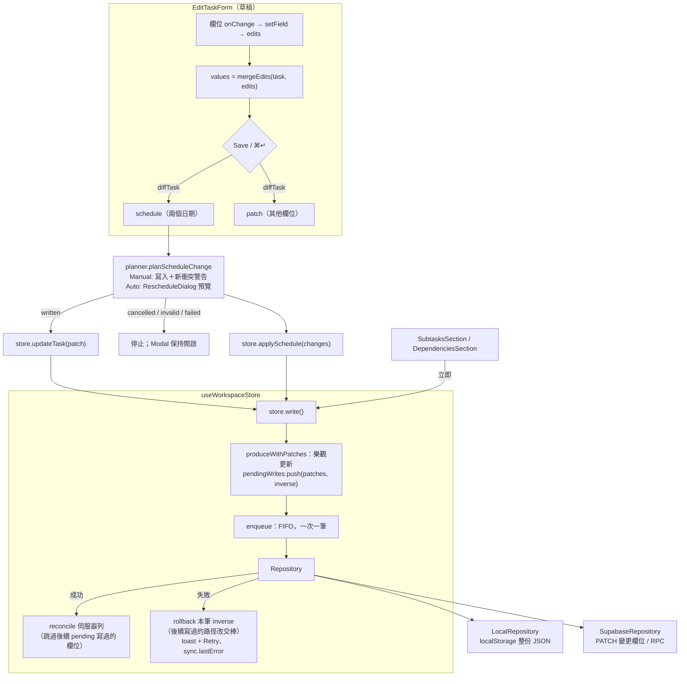
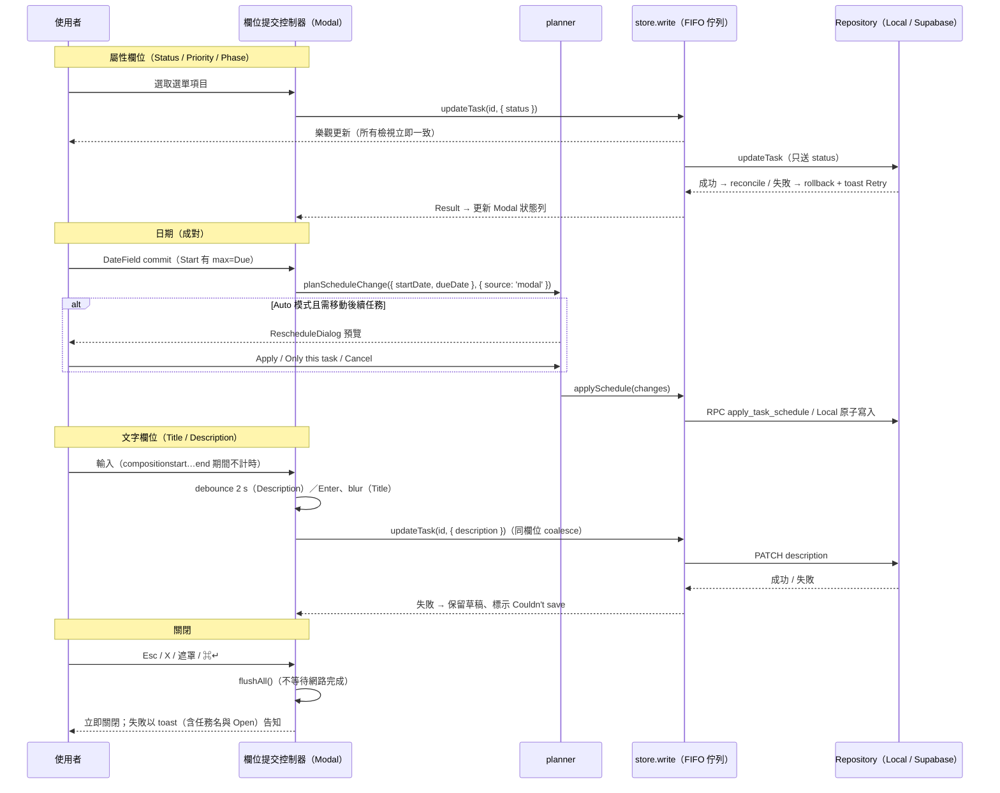

# Task Modal 自動儲存（auto-save）設計評估

> 狀態：**設計提案，尚未實作**。本文件只描述現況與建議；`src/`、`e2e/`、`supabase/` 均未修改。
> 分支：`ux/iteration-3`（含他人尚未提交的 UI 修改；`src/features/list/*` 正由他人修改，本文只引用其行為作對照，行號以撰寫當下的工作區為準）。
> 對應問題：`docs/ux-audit.md` X-1（兩種儲存模型並存）、X-9（從子任務 Save 後整個 Modal 關閉）。

標記說明：**【實測】** 在瀏覽器實際操作的結果；**【推論】** 由程式推得、未實際執行；**【未驗證】** 不確定、需要再確認；沒有標記的現況敘述都附 `path:line` 出處。

---

## 結論摘要

1. **資料層已經能承受「逐欄位立即寫入」**：寫入是單一 FIFO 佇列逐筆送出（`src/data/store.ts:703-707`、`910-972`），每筆有自己的 inverse patches；先失敗的寫入若被後面的寫入覆蓋同一路徑，回滾會把舊值「交棒」給後者而不是蓋掉新值（`store.ts:718-733`），較新的變更會撤回舊失敗的 Retry（`store.ts:804-827`）。這些都有單元測試（`src/data/store.test.ts:248-349`、`1493-1716`）。**自動儲存不需要新的儲存佇列。**
2. **最大的缺口在 Modal 這一層，不在 store**：目前 Modal 是「只記住改過欄位」的草稿（`src/features/task-modal/formModel.ts:1-8`、`77-82`），Save 才把日期與其他欄位分成兩次寫入（`EditTaskForm.tsx:203-250`）。自動儲存需要一個新的「欄位提交控制器」：文字欄位的草稿、IME 組字閘門、失焦／關閉／分頁隱藏時的 flush、同欄位合併（coalescing）、失敗時把文字還給使用者。
3. **中文 IME 是文字欄位自動儲存的頭號風險**：組字期間 React 的 `onChange` 已經把注音拼字放進草稿（【實測】E8：值為 `ㄓㄨ` 時 Save 已變成可按）。現有程式只處理了 Enter／Esc（`keys.ts:4-23`、`dialogGuards.ts:95-97`），**debounce 與 blur 都沒有組字保護**，必須新增 `compositionstart/end` 閘門。
4. **使用者提案大致合理，但有 4 處建議調整**：(a) Description 的 debounce 應拉長到約 2 秒並受組字閘門控制，且不為每次 debounce 出 Undo toast；(b) Start／Due 要先讓 Modal 的開始日跟 List 一樣不能選在截止日之後（`EditTaskForm.tsx:414-418` 目前沒有 `max`，`TaskRow.tsx:240` 有），且每次都送「兩個日期一起」；(c) 空標題在失焦時應退回上次存好的標題，而不是卡住；(d) Esc 應改為「保留並關閉」而非「詢問是否丟棄」。
5. **Local 與 Cloud 都是欄位層級的「後寫者勝」，沒有版本檢查**：Supabase 只送有變的欄位（`mappers.ts:140-150`、`supabaseRepository.ts:481-491`），Local 把 patch 合併到最新存檔的那一列（`localRepository.ts:764-797`）；`updated_at` 只是 trigger 維護的時間戳（`supabase/migrations/20261102000000_init.sql:213-223`），沒有任何 `where updated_at = ?` 檢查。自動儲存不會讓這件事變糟（仍只送改過的欄位），但 Description 的跨裝置覆蓋風險值得在 Phase 5 用欄位層級前置條件處理（需改 RPC／schema，本文只提建議）。
6. **失敗後的資料找回目前只靠記憶體中的 Retry**：失敗寫入的 Retry 存在 store closure（`store.ts:665`），重新整理就消失；沒有離線佇列（`docs/architecture.md:171-173`、D14）。【實測】E4b：儲存中按 Esc 關閉、寫入隨後失敗，畫面回到舊標題，只剩 toast（8 秒，`src/lib/notify.ts:60-74`）與側邊欄的 Retry 能救回。自動儲存要補上「草稿登記表＋toast 帶任務名稱與 Open」。
7. **建議分 5 階段上線**（第 8 節），前 3 階段約 8–11 人日即可移除 Save／Cancel；Cloud 樂觀並發控制列為選配的第 5 階段。

## 這份文件的證據與限制

| 類別               | 內容                                                                                                                                                                                                                                                                                        |
| ------------------ | ------------------------------------------------------------------------------------------------------------------------------------------------------------------------------------------------------------------------------------------------------------------------------------------- |
| 實測（Local 模式） | 以 `VITE_DATA_MODE=local npx vite --mode e2e --port 5193` 啟動，Playwright `chromium.launchPersistentContext`，透過 `localStorage['cairn:local:workspace:v1']` 注入資料，用 `window.__cairnTest.failNextWrites` / `setLatency` 模擬失敗與延遲。共 8 組（E1–E8，見下表）。結束後已關閉行程。 |
| 只讀程式           | Supabase（Cloud）模式的所有行為、跨裝置競態、Safari 的事件順序（引用 `e2e/ime.helpers.ts:20-23` 與 `src/lib/keyboard.ts:133-139` 的既有記錄）、離線行為、`pagehide` 時的寫入。                                                                                                              |
| 未做               | 未連 Supabase、未在 Safari／Firefox 實測、未量測真實網路延遲、未執行既有測試套件。                                                                                                                                                                                                          |
| 實測腳本與原始輸出 | `/private/tmp/claude-501/-Users-aa0922900373-Projects-cairn/4d81fbc9-c78b-4d1a-8d88-8e402ede9276/scratchpad/autosave-research/probe.mjs`、`probe-out.txt`、`probe-out-late.txt`（暫存，非 repo 內容）。                                                                                     |

**實測紀錄**（Local 模式，Chromium headless）：

| #   | 步驟                                                                                             | 結果                                                                                                                                                                                                                                                |
| --- | ------------------------------------------------------------------------------------------------ | --------------------------------------------------------------------------------------------------------------------------------------------------------------------------------------------------------------------------------------------------- |
| E1  | 開任務 → Status 選 In Progress（不按 Save）→ 讀存檔 → Esc                                        | 存檔仍為 `todo`；Esc 跳出「Discard changes? / Keep editing / Discard」。另觀察到：選單一關閉**立刻**按 Esc 時沒有任何反應，等 600 ms 再按才出現詢問（原因未驗證，疑為選單退場動畫仍攔截 Esc）。                                                     |
| E2  | 在「Add subtask」輸入並 Enter → Cancel                                                           | 子任務立刻寫入存檔；Save 仍是停用；Cancel 直接關閉、不詢問；子任務保留。（與 X-1 一致）                                                                                                                                                             |
| E3  | `failNextWrites(1)` → Priority 選 High → Save                                                    | Modal 保持開啟、晶片仍顯示 High（草稿保留）；存檔未變；toast「Couldn't update task · Network error — check your connection. · Retry」；側邊欄 `failed`；Esc 會詢問丟棄。按 toast 的 Retry → 存檔變 High、toast「Saved」、Modal 仍開著（需手動關）。 |
| E4a | `setLatency(1500)` → 改標題 → Save → 200 ms 後按 Esc                                             | **不詢問、立即關閉**；側邊欄 `saving`；關閉當下存檔仍是舊標題，1.5 秒後寫入完成。                                                                                                                                                                   |
| E4b | 同 E4a 再加 `failNextWrites(1)`                                                                  | Modal 已關閉；寫入失敗後存檔與 List 都回到舊標題；只剩 toast 與側邊欄 Retry 帶著這筆修改。                                                                                                                                                          |
| E5  | 設 Start=Today、Due=Next week、改標題 → `setLatency(800)` → Save → 300 ms 後 `failNextWrites(1)` | **部分成功**：日期已寫入，標題沒有；Modal 保持開啟，標題欄仍是新字；toast「Couldn't update task」。                                                                                                                                                 |
| E6  | 改標題（不存）→ 重新整理                                                                         | 出現瀏覽器 `beforeunload` 提示（Local 模式也有，來自 `NavigationGuard`）；接受後存檔為舊標題。                                                                                                                                                      |
| E7  | 任務 Due=2026-11-01 → 開 Start date → 選 Today（11-06）                                          | Start 的 Today **可以選**；選後出現行內錯誤「Due date can't be before the start date.」，Save 停用。                                                                                                                                                |
| E8  | 在 Description 用 CDP `Input.imeSetComposition('ㄓㄨ')` 組字 → `Input.insertText('專')`          | 組字中 textarea 值為 `ㄓㄨ`，**Save 已可按**（草稿含未確認的注音）；commit 後值為 `專`。事件順序：`compositionstart → compositionupdate → input(isComposing) → … → compositionend`。                                                                |

---

## 1. 現有儲存流程

### 1.1 開啟、草稿與關閉

| 階段           | 現況                                                                                                                                                                                                                                           | 出處                                                                                                                  |
| -------------- | ---------------------------------------------------------------------------------------------------------------------------------------------------------------------------------------------------------------------------------------------- | --------------------------------------------------------------------------------------------------------------------- |
| 開啟           | 任何路由帶 `?task=<id>` 即開啟編輯；`useUIStore().newTask` 開啟建立。同一個 Radix Dialog 承載兩種表單。                                                                                                                                        | `TaskModalHost.tsx:1-9`、`80-95`                                                                                      |
| 資料來源       | `EditTaskForm` 用 `useTask(taskId)` 綁 store 的**即時**任務；任務消失時保留最後版本以完成退場動畫。                                                                                                                                            | `EditTaskForm.tsx:89-95`、`src/data/hooks.ts:104-106`                                                                 |
| 草稿模型       | `edits: TaskFormEdits` 只存「使用者動過的欄位」，畫面值 = 即時任務 + edits。沒動過的欄位會跟著別處的變更更新；動過的欄位以草稿為準。                                                                                                           | `formModel.ts:1-8`、`34-35`、`77-82`；`EditTaskForm.tsx:117`、`123`                                                   |
| 髒值判斷       | `formDirty = !isUnchanged(diffTask(task, edits))`；`dirty` = `formDirty` 或「Add subtask」行有字（`subtaskDraft`）。                                                                                                                           | `EditTaskForm.tsx:125-126`                                                                                            |
| Save 組 patch  | `diffTask` 拆成 `schedule`（兩個日期，只要有一個變就整對送）與 `patch`（其餘真的有變的欄位；標題 trim、空描述轉 null；子任務不改階段）。                                                                                                       | `formModel.ts:96-128`                                                                                                 |
| Save 執行      | 先驗證；**先**以 `planScheduleChangeDetailed(schedule, { source: 'modal' })` 寫日期（Manual 警告、Auto 預覽；取消／失敗就停，其他欄位都不送），**再**以 `updateTask(patch)` 寫其餘欄位。成功且期間沒有新輸入、也沒有未送出的子任務行，才關閉。 | `EditTaskForm.tsx:203-250`                                                                                            |
| 失敗           | 遠端失敗由 store 回滾＋toast（含 Retry）；`validation`／`not_found` 另在 Modal 內顯示 `formError`。草稿保留，可再按 Save。【實測】E3。                                                                                                         | `EditTaskForm.tsx:225-233`                                                                                            |
| 關閉           | Esc、遮罩、X、Cancel 都走 `requestClose` → `confirmLeave`：有髒值且**不在儲存中**才問「Discard changes?」；儲存中直接關閉（【實測】E4a）。                                                                                                     | `TaskModalHost.tsx:223-231`；`EditTaskForm.tsx:172-180`；`discard.ts:4-12`                                            |
| 未存防護       | 髒值時掛 `NavigationGuard`：攔 react-router 導航（保留同一個 `?task=` 的除外）並問丟棄；同時 `useUnloadPrompt(true)` 讓關分頁／重新整理出現瀏覽器提示（【實測】E6）。                                                                          | `EditTaskForm.tsx:510`；`NavigationGuard.tsx:14-48`；`useUnloadPrompt.ts:4-15`                                        |
| 換到別的任務   | 麵包屑、子任務列、依賴晶片都走 `leave()` → `confirmLeave`。                                                                                                                                                                                    | `EditTaskForm.tsx:195-201`                                                                                            |
| ⌘K → New task  | 表單有未存內容時，新的建立請求先被「扣住」，問完丟棄才換。                                                                                                                                                                                     | `TaskModalHost.tsx:86-94`、`122-146`                                                                                  |
| 快捷鍵         | `⌘↵`／`Ctrl+↵` 在 Modal 內任何地方都觸發 Save。                                                                                                                                                                                                | `TaskModalHost.tsx:247-252`；`keys.ts:8-11`                                                                           |
| 立即寫入的區塊 | 子任務（新增、改狀態）與依賴（新增、移除）不屬於 Save 表單，直接呼叫 store action；畫面有一行說明。                                                                                                                                            | `EditTaskForm.tsx:472-490`；`SubtasksSection.tsx:29-31`、`59-75`、`97-100`；`DependenciesSection.tsx:44-49`、`83-102` |
| 刪除           | 「More actions → Delete task…」先確認（有子任務時選擇保留或一起刪），確認後**先關閉**再 `deleteTask`，成功 toast，無 Undo。                                                                                                                    | `EditTaskForm.tsx:255-290`                                                                                            |
| 建立模式       | 建立表單是完整草稿（`values`），按 Create 才 `createTask`；失敗保留表單，Toast Retry 成功時自動關閉（`useRetryFulfilment`）。                                                                                                                  | `CreateTaskForm.tsx:87-107`、`120-132`、`166-200`；`retryFulfilment.ts:1-11`                                          |

### 1.2 資料流圖（現況）



### 1.3 兩種 Repository 的更新方式

| 項目                 | Local（`LocalRepository`）                                                                                                             | Cloud（`SupabaseRepository`）                                                                                                                                                    |
| -------------------- | -------------------------------------------------------------------------------------------------------------------------------------- | -------------------------------------------------------------------------------------------------------------------------------------------------------------------------------- |
| `updateTask`         | 讀最新存檔 → 複製該列 → 只套用 patch 中有定義的欄位 → 模擬 trigger（completed_at、子任務階段）→ 整份 DB 序列化寫回 `localStorage`。    | `PATCH tasks?id=eq.<id>`，只送 patch 有的欄位（`taskPatchToRow`），`.select().single()` 取回整列。                                                                               |
| 出處                 | `localRepository.ts:764-810`、`986-1005`                                                                                               | `supabaseRepository.ts:295-297`、`481-491`；`mappers.ts:140-150`、`292-294`                                                                                                      |
| 日期                 | `applySchedule`：全部驗證後一次改完，失敗就不寫（同一份 DB 副本）。                                                                    | RPC `apply_task_schedule`：all-or-nothing，任何一筆缺失或 due<start 就整批 raise。                                                                                               |
| 出處                 | `localRepository.ts:878-909`                                                                                                           | `supabaseRepository.ts:338-361`；`20261102000000_init.sql:594-677`                                                                                                               |
| 原子性               | 每次呼叫原子（先在副本上改，成功才 `setItem`）。                                                                                       | 單列 PATCH 原子；RPC 原子。**同一次 Save 的「日期 + 其他欄位」是兩次呼叫，不原子**（【實測】E5）。                                                                               |
| 版本檢查             | 無。                                                                                                                                   | 無。`updated_at` 由 `tg_set_updated_at` 設為 `now()`（`init.sql:213-223`、`493-495`），沒有任何條件式更新。                                                                      |
| 跨分頁／跨裝置可見性 | 同一瀏覽器的其他分頁**不會**即時收到變更（工作區沒有 `storage` 事件監聽；`onStorageKey` 只用於檢視偏好，`src/lib/storage.ts:43-51`）。 | 無 realtime 訂閱；只在 focus／分頁可見／重新上線時 silent refresh，節流 30 秒（`store.ts:2309-2345`；`docs/architecture.md:161-166`）。                                          |
| 逾時                 | 無網路；`setLatency` 只是測試延遲（`localRepository.ts:683-685`、`1075-1078`）。                                                       | 每個請求 30 秒期限（`supabaseClient.ts:10`、`41-67`）。                                                                                                                          |
| 失敗模擬             | `failNextWrites(n)`：接下來 n 次寫入丟 `network` 錯誤且不寫入（`localRepository.ts:678-681`、`986-990`）。只在 dev／e2e build 安裝。   | 無模擬；錯誤由 `toRepositoryError` 分類：network／unknown 可重試，validation／not_found／permission／auth／conflict 不可（`supabaseRepository.ts:156-221`；`errors.ts:38-41`）。 |
| 真實失敗來源         | 幾乎只有儲存空間滿（`unknown`，可重試，`localRepository.ts:994-1002`）。                                                               | 網路、逾時、伺服器忙、權限、session 過期、資料已被別處刪除。                                                                                                                     |

**一致性判斷**：兩者語意刻意對齊（D4；`localRepository.parity.test.ts`），對同一個 patch 的結果相同；差別在「失敗機率與型態」與「延遲」。Local 的寫入在微任務內完成【推論】，所以 Local 模式幾乎看不到 Saving 狀態，也幾乎不會失敗。

### 1.4 Store：樂觀更新、佇列與回復

| 機制                   | 行為                                                                                                                                                                          | 出處                                      |
| ---------------------- | ----------------------------------------------------------------------------------------------------------------------------------------------------------------------------- | ----------------------------------------- |
| 序列化                 | 所有寫入經 `enqueue` 串成一條 Promise 鏈，依使用者操作順序一次送一筆；同一任務的連續寫入因此不會亂序抵達。                                                                    | `store.ts:13-15`、`703-707`、`930`        |
| 樂觀更新               | `produceWithPatches` 產生欄位層級 patches／inverse，`pendingWrites` 依送出順序記錄。                                                                                          | `store.ts:218-226`、`918-926`             |
| 失敗回復（只回這一筆） | `rollback` 逐一檢查本筆的 inverse：若**後面還在等待**的寫入也動過同一路徑（或其祖先），不套用，而是把舊值「交棒」給那筆（之後它也失敗時，欄位回到最後存好的值）；否則才套用。 | `store.ts:16-19`、`718-733`、`336-351`    |
| 成功對帳               | `reconcile` 把伺服器列合併回來，但跳過後續 pending 寫入動過的欄位，並把那筆的回復值改成伺服器值。                                                                             | `store.ts:20-21`、`745-768`               |
| Retry                  | 可重試的失敗記為 `RetryHandle`（含 `paths`、`patches`、`seq`）；toast 的 Retry 送出「上次成功之後所有失敗」，依原順序；全部成功後顯示一次「Saved」（D13）。                   | `store.ts:233-252`、`829-890`、`979-1026` |
| 較新變更撤回舊 Retry   | 新寫入動到與舊失敗相同的欄位時，舊 Retry 標為 stale 並關掉 toast，避免 Retry 用舊值蓋新值。                                                                                   | `store.ts:24-26`、`804-827`               |
| 失敗後重讀             | 失敗後（線上時）在佇列清空後 silent refresh；快照若已包含失敗的修改，視為其實已存好並撤回錯誤。                                                                               | `store.ts:842-847`、`1055-1083`           |
| Refresh 與 pending     | 有 pending 寫入時不 refresh；refresh 期間若有新寫入開始，丟棄這份快照並稍後重讀；套用快照時把仍在等待的寫入重新疊上去。                                                       | `store.ts:1173-1189`、`1035-1053`         |
| `updateTask` 的 Retry  | `retry: () => updateTask(id, patch)`：以「當時的意圖」重新對**目前**的任務套用（再次驗證、只送有差異的欄位）。                                                                | `store.ts:1719-1727`                      |
| 狀態                   | `sync = { pending, lastError, lastSavedAt, lastLoadedAt, online, canRetry }`。                                                                                                | `contracts.ts:182-200`                    |

**「失敗時只回復那一筆是否安全？」** 對**同一欄位**是安全的：後寫入的值保留（它是使用者最新的意圖），測試見 `store.test.ts:283-337`。對**不同欄位但語意相依**的寫入（例如 A 改開始日、B 依 A 的新開始日改截止日）store 不知道相依性：A 失敗、B 成功會留下「開始日舊、截止日新」【推論】。目前 Modal 與 List 都把兩個日期**成對**送出（`formModel.ts:121-126`；`ListView.tsx:265-274`），所以這個情況不會發生；自動儲存必須保留「成對送出」這條規則（第 3 節）。

---

## 2. 目前存在的 UX 不一致問題

| #    | 問題                                                                                                                       | 證據                                                                                                        | 對照 ux-audit |
| ---- | -------------------------------------------------------------------------------------------------------------------------- | ----------------------------------------------------------------------------------------------------------- | ------------- |
| U-1  | 同一個 Modal 內兩種儲存模型：屬性要 Save，子任務／依賴立即寫入，靠一行小字說明。                                           | `EditTaskForm.tsx:472-478`；【實測】E1、E2                                                                  | X-1           |
| U-2  | 加了子任務後按 Cancel 不會提示，子任務也不會撤銷；「Cancel」名不副實。                                                     | 【實測】E2；`confirmLeave` 只看 `dirty`（`EditTaskForm.tsx:172-176`）                                       | X-1           |
| U-3  | 同一欄位在不同位置規則不同：List 的狀態、優先度、日期都是選了就存；Modal 要按 Save。                                       | `ListView.tsx:263-274`；`Board.tsx:179-201`；`useTaskStatusChange.ts:49`                                    | X-1           |
| U-4  | Modal 的開始日可以選在截止日之後，選完才報錯並停用 Save；List 的開始日直接不讓選。                                         | `EditTaskForm.tsx:414-418`（無 `max`）vs `TaskRow.tsx:236-247`（`max={task.dueDate}`）；【實測】E7          | —（新發現）   |
| U-5  | 一次 Save 可能只存了一半：日期已寫入、其他欄位失敗，畫面沒有說明哪些存了。                                                 | `EditTaskForm.tsx:220-234`（兩次寫入）；【實測】E5                                                          | —（新發現）   |
| U-6  | 儲存中可以直接關閉、不提示；若之後失敗，修改只剩 8 秒的 toast 與側邊欄 Retry 能救回。                                      | `EditTaskForm.tsx:174`（`savingRef` 時直接放行）；`notify.ts:60-74`；【實測】E4a、E4b                       | —（新發現）   |
| U-7  | Toast 的 Retry 成功後 Modal 仍開著，使用者不知道還要不要按 Save（Save 已停用）。                                           | 【實測】E3                                                                                                  | —             |
| U-8  | Undo 只在部分入口提供：Gantt 改日期、Gantt 移除依賴、My Tasks 標為完成（且離開清單時）有 Undo；Modal、List、Board 都沒有。 | `dateUndo.ts:1-13`；`GanttChart.tsx:866-897`；`useTaskStatusChange.ts:55-64`                                | X-12（刪除）  |
| U-9  | 從父任務進入子任務並 Save 後整個 Modal 關閉，不回父任務。原因：`closeTask` 依歷史深度一次退回 `cairnTaskDepth` 層。        | `useCloseTask`：`src/app/taskModalRoute.ts:57-80`；`EditTaskForm.tsx:249`                                   | X-9           |
| U-10 | 標題的 Enter 在建立模式會送出，在編輯模式只擋換行、什麼都不做。                                                            | `fields.tsx:40-41`、`71-77`；`EditTaskForm.tsx:385-390`（未傳 `onEnter`）；`acceptance-ime.spec.ts:469-472` | —             |
| U-11 | 狀態 Undo 沒有「是否已被改過」的檢查，Undo 可能蓋掉較新的修改；日期 Undo 有。                                              | `useTaskStatusChange.ts:61`（直接 `updateTask(previous)`）vs `planner.ts:243-257`（`stale` 檢查）           | —             |
| U-12 | 選單剛關閉時立刻按 Esc 沒有反應（等約 0.6 秒才有效）。                                                                     | 【實測】E1（原因未驗證）                                                                                    | —             |

### 2.1 各欄位現況對照表

「立即」= 選了就寫入 store／Repository；「Save」= 要按 Modal 的 Save；「—」= 該處不能改。

| 欄位         | Task Modal                                    | List                                                           | Board                                              | My Tasks                            | Gantt                                                              | Undo                                                                       |
| ------------ | --------------------------------------------- | -------------------------------------------------------------- | -------------------------------------------------- | ----------------------------------- | ------------------------------------------------------------------ | -------------------------------------------------------------------------- |
| 標題         | Save（`EditTaskForm.tsx:385-390`）            | —（只有 Modal 能改；List 只改階段名）                          | —                                                  | —                                   | —                                                                  | 無                                                                         |
| 描述         | Save（`EditTaskForm.tsx:392-396`）            | —                                                              | —                                                  | —                                   | —                                                                  | 無                                                                         |
| 狀態         | Save（`404-408`）                             | 立即（`ListView.tsx:263`）                                     | 立即：選單或拖到別欄（`Board.tsx:179-191`、`155`） | 立即（`useTaskStatusChange.ts:49`） | —                                                                  | 僅 My Tasks「標為完成且離開清單」有 Undo（`useTaskStatusChange.ts:55-64`） |
| 優先度       | Save（`409-413`）                             | 立即（`ListView.tsx:264`）                                     | 立即（`Board.tsx:194-201`）                        | —                                   | —                                                                  | 無                                                                         |
| 開始／截止日 | Save，經 planner（`220-224`）                 | 立即，經 planner（`ListView.tsx:265-274`）                     | —（只顯示截止日）                                  | —                                   | 立即，經 planner；拖曳、縮放、鍵盤微調（`GanttChart.tsx:781-799`） | 僅 Gantt（`dateUndo.ts`，8 秒內同任務連續修改合併）                        |
| 階段         | Save（`438-442`；子任務鎖定）                 | 立即：「Move to phase」或拖曳（`ListView.tsx:293-296`、`170`） | —                                                  | —                                   | —                                                                  | 無                                                                         |
| 子任務       | 立即（`SubtasksSection.tsx:59-75`、`97-100`） | 立即（行內新增）                                               | —（只顯示數量）                                    | 狀態立即                            | —                                                                  | 無                                                                         |
| 依賴         | 立即（`DependenciesSection.tsx:83-102`）      | —                                                              | —                                                  | —                                   | 立即：拖曳連線、移除（`GanttChart.tsx:1073`、`874`）               | 僅 Gantt 移除依賴（`GanttChart.tsx:882-893`）                              |
| 排序         | —                                             | 立即（拖曳、上下移）                                           | 立即（拖曳）                                       | —                                   | —                                                                  | 無                                                                         |
| 刪除         | 確認後立即（`255-290`）                       | 確認後立即（`ListView.tsx:208-225`）                           | —                                                  | —                                   | —                                                                  | 無（X-12）                                                                 |

**結論**：Modal 是全站唯一要按 Save 的地方，而且只有它能改標題與描述。自動儲存在屬性與日期上是「向 List 對齊」，在文字欄位上是新行為。

---

## 3. 建議自動儲存行為

### 3.1 原則

| #   | 原則                                                                                                                    | 理由                                                                                             |
| --- | ----------------------------------------------------------------------------------------------------------------------- | ------------------------------------------------------------------------------------------------ |
| P1  | **逐欄位提交**，每個欄位用既有的 store action（`updateTask`／planner），不合併成一次大寫入。                            | store 的佇列、回滾交棒、Retry 撤回都以欄位路徑為單位設計（1.4 節）；合併反而讓部分失敗更難表達。 |
| P2  | 日期永遠**成對**送出（`{ startDate, dueDate }`），一律經 `planScheduleChange`。                                         | 保持 Manual／Auto 規則與 List、Gantt 一致（`docs/architecture.md:228-234`），避免跨欄位不一致。  |
| P3  | **關閉不丟資料**：任何「離開」動作（Esc、X、遮罩、換任務、⌘↵）都先 flush 有效草稿，再離開；不再問「Discard changes?」。 | 自動儲存的使用者預期是「關掉就是存了」。                                                         |
| P4  | **組字中不儲存**：`compositionstart` 到 `compositionend` 之間不觸發任何儲存。                                           | 【實測】E8：組字中草稿已含注音。                                                                 |
| P5  | 正在輸入的文字欄位，畫面以草稿為準，store 的對帳結果不能讓游標跳動。                                                    | `reconcile` 會把伺服器值寫回 store（`store.ts:745-768`）。                                       |
| P6  | 失敗時文字欄位保留使用者打的字並標示失敗；屬性欄位沿用 store 回滾＋Retry。                                              | 文字是使用者的勞動成果；屬性一鍵就能重選。                                                       |
| P7  | 建立模式**不**自動儲存，保留 Create 按鈕。                                                                              | 任務還不存在；自動建立會在使用者打第一個字時產生半成品任務（見第 9 節 Q6）。                     |

### 3.2 逐欄位規則

| 欄位          | 觸發時機                                                                                                                                               | 驗證                                                                                                                                   | 失敗處理                                                                                                                             | Undo                                                                                              | 與現況差異                                                      |
| ------------- | ------------------------------------------------------------------------------------------------------------------------------------------------------ | -------------------------------------------------------------------------------------------------------------------------------------- | ------------------------------------------------------------------------------------------------------------------------------------ | ------------------------------------------------------------------------------------------------- | --------------------------------------------------------------- |
| Status        | 選單項目被選取（`onValueChange`）即呼叫 `updateTask({ status })`。                                                                                     | store 列舉驗證（`store.ts:1684-1693`）。                                                                                               | store 回滾＋toast Retry；Modal 狀態列顯示「Couldn't save · Retry」。                                                                 | 不出 toast（晶片本身就是回饋，重選即可）；見 Q4。                                                 | 由 Save 改為立即。與 List／Board 一致。                         |
| Priority      | 同上。                                                                                                                                                 | 同上。                                                                                                                                 | 同上。                                                                                                                               | 同上。                                                                                            | 同上。                                                          |
| Phase         | 同上；子任務維持鎖定（`EditTaskForm.tsx:429-436`）。                                                                                                   | `phaseError`（`store.ts:1703-1706`）；父任務改階段時子任務跟著改（`1537-1546`）。                                                      | 同上。                                                                                                                               | 同上。                                                                                            | 同上。與 List「Move to phase」一致。                            |
| Start／Due    | DateField 的 `commit`（選日、快速選項、Clear）即送出**整對**日期給 planner（`DateField.tsx:79-82`）。                                                  | Modal 的 Start 加 `max={dueDate}`、Due 保留 `min={startDate}`，讓無效範圍選不到（同 List）。planner 再驗一次（`planner.ts:268-269`）。 | `failed`：store 回滾＋Retry；`invalid`：行內訊息；`cancelled`（Auto 預覽按 Cancel）：晶片回到已存值，行內一行「Dates not changed」。 | 可沿用 `ScheduleWriteRecord`＋stale 檢查（`planner.ts:152-160`、`243-257`）；是否出 toast 見 Q4。 | 由 Save 改為立即；Start 新增 `max`；Cancel 預覽不再保留草稿。   |
| Title         | `Enter`（非組字、無修飾鍵）或 `blur`；關閉 Modal 前 flush。                                                                                            | 空白 → 不送出，**退回已存標題**並以行內提示說明；超過 500 字元 → 不送出，保留草稿與錯誤（`validation.ts:63-70`）。                     | 保留草稿、欄位標示失敗、狀態列 Retry；Retry 成功後草稿自動清除。                                                                     | 無 toast；欄位內 ⌘Z 為瀏覽器原生行為【未驗證：受控 textarea 的原生 undo 堆疊】。                  | 由 Save 改為 Enter／blur；Enter 從「無作用」變為「存檔」。      |
| Description   | 停止輸入 **2 秒**後送出（debounce，組字中暫停計時）；`blur`、關閉、`visibilitychange: hidden` 立即 flush；連續輸入超過 10 秒時強制送一次（max-wait）。 | 超過 10,000 code points → 不送出、保留草稿與計數器紅字（`fields.tsx:96-118`）。空白存成 `null`（`formModel.ts:52-55`）。               | 同 Title。                                                                                                                           | 無 toast；見 Q4。                                                                                 | 由 Save 改為 debounce＋blur。                                   |
| Subtasks      | 維持現況：Enter 新增、狀態選了就存。                                                                                                                   | 維持（`SubtasksSection.tsx:59-75`）。                                                                                                  | 維持：失敗把文字還回輸入行、Retry 成功時清除（`SubtasksSection.tsx:53-57`、`68-74`）。                                               | 無。                                                                                              | 輸入行有字時關閉：由「問丟棄」改為見 Q5。                       |
| Dependencies  | 維持現況：選取候選即新增、按 × 即移除。                                                                                                                | 維持（`validateNewDependency`）。                                                                                                      | 維持。                                                                                                                               | 可比照 Gantt 的移除 Undo（`GanttChart.tsx:882-893`）。                                            | 移除那行說明文字。                                              |
| Delete        | 維持確認對話框。                                                                                                                                       | —                                                                                                                                      | 維持。                                                                                                                               | 不在本案做（Undo 需要還原子任務、依賴與排序鍵，Cloud 需新 RPC）。                                 | 刪除前**丟棄**本 Modal 尚未送出的草稿（避免對已刪任務送更新）。 |
| Auto Schedule | 維持預覽與確認（`planner.ts:297-302`）。                                                                                                               | —                                                                                                                                      | 預覽中 Cancel 不寫入。                                                                                                               | 「Apply」整批可 Undo（同一個 record，`planner.ts:152-160`）。                                     | 觸發頻率變高（每次挑日期），見風險 R9。                         |

### 3.3 對使用者提案的逐條判斷

| 提案                                   | 判斷                 | 理由與調整                                                                                                                                                                                                                                                                                                                                                                                                                                                |
| -------------------------------------- | -------------------- | --------------------------------------------------------------------------------------------------------------------------------------------------------------------------------------------------------------------------------------------------------------------------------------------------------------------------------------------------------------------------------------------------------------------------------------------------------- |
| Status、Priority、Phase 選擇後立即儲存 | **合理**             | 與 List、Board 現況一致（2.1 節）；單欄位寫入，store 已處理競態。唯一要注意：Status 改成 Done 會設定 `completedAt`（`store.ts:1533-1536`），連續切換只會留下最後一次，沒有問題。                                                                                                                                                                                                                                                                          |
| Start／Due 完成選擇後儲存              | **需調整**           | (1)「完成」定義為 **DateField 的 `commit`**（選日、Today／Tomorrow／Next week、Clear；三者都會關閉 popover，`DateField.tsx:79-82`）；Esc 或點外面關閉 popover **不是**完成，不送出。(2) 必須先讓 Start 不能選在 Due 之後（U-4），否則「選完就存」會在中間狀態撞到 `due >= start`。(3) 每次送整對日期。(4) 已完成任務：使用者明確編輯的日期照常寫入，D24 只限制「自動」移動（`docs/decisions.md:134-139`）。(5) Auto 模式下每次挑日期都可能跳預覽，見 R9。 |
| Title：Enter 或失焦時儲存              | **合理，需補三點**   | (1) Enter 要排除組字（Safari 的確認 Enter 是 `keyCode 229` 且 `isComposing=false`，現有 `isPlainEnter` 已涵蓋，`keys.ts:4-6`、`14-23`）。(2) 空標題：**不建議**卡住使用者或跳對話框，建議退回已存值並提示（Q3）。(3) Esc：建議「保留並關閉」，不建議「放棄這次編輯」（Q2）。                                                                                                                                                                              |
| Description：適度 debounce，失焦時補存 | **需調整**           | (1) 時間建議 **2 秒**而非常見的 300–800 ms：描述是長文字，短 debounce 會在每個停頓產生寫入，Cloud 每次送最多 10,000 字的 PATCH，且讓 Saving 狀態一直閃。2 秒對應「停下來想」的自然停頓【推論；無使用者研究佐證，可在 Phase 3 以設定常數調整】。(2) 組字中暫停計時（P4）。(3) 每個欄位最多一筆在途寫入＋一個待送值（coalescing），網路慢時不會排一長串。(4) **不**為每次 debounce 出 Undo（粒度太碎）。(5) max-wait 10 秒，避免長時間不停打字時完全沒存。  |
| Subtasks、Dependencies：確認操作後儲存 | **合理（已是現況）** | 現況就是立即寫入。要處理的是一致性：移除「Subtasks and dependencies save right away.」說明；Cancel 按鈕移除後，沒有「取消」可以撤銷子任務／依賴，這與屬性欄位一致（都沒有取消）。「Add subtask」輸入行有字時關閉的處理見 Q5。                                                                                                                                                                                                                             |
| Delete：保留確認或可靠的 Undo          | **合理：保留確認**   | 可靠的 Undo 需要重建任務、子任務、依賴與排序鍵；Cloud 要新 RPC 或多次寫入，且 `delete_task` 有「保留子任務並提升」的變體（`supabaseRepository.ts:298-313`）。現有確認對話框清楚（ux-audit X-12 也評為風險可控），不在本案處理。                                                                                                                                                                                                                           |
| Auto Schedule：保留預覽與確認          | **合理**             | 預覽是「會移動其他任務」的唯一告知管道（`planner.ts:5-10`）。調整點：預覽按 Cancel 後，Modal 的日期晶片要回到已存值（目前會保留草稿，`saveModel.test.tsx:47`）。                                                                                                                                                                                                                                                                                          |

### 3.4 Modal 外框的改變

| 項目                 | 建議                                                                                                                                   |
| -------------------- | -------------------------------------------------------------------------------------------------------------------------------------- |
| Save／Cancel 按鈕    | 移除。Footer 左側保留時間戳，右側改為儲存狀態（第 6 節）。是否保留一個「Done」按鈕見 Q1。                                              |
| `⌘↵`                 | 改為「flush 並關閉」（與 Done 相同），保留肌肉記憶。                                                                                   |
| Esc／X／遮罩         | flush 有效草稿後關閉，不詢問。                                                                                                         |
| `NavigationGuard`    | 只在「有尚未送出的草稿」時掛載（debounce 窗口、無效標題、失敗待重試的文字），範圍比現在小很多。                                        |
| 換到其他任務／專案頁 | 先 flush 再導航（取代 `confirmLeave`，`EditTaskForm.tsx:195-201`）。                                                                   |
| ⌘K → New task        | 「扣住」邏輯（`TaskModalHost.tsx:86-94`）改看「是否有無法自動存的草稿」（如空標題、超長描述）；一般情況直接 flush 後切換。             |
| X-9                  | 沒有 Save 之後「Save 關掉整個堆疊」的情境消失；但 Esc 從子任務仍會一次退回所有層（`taskModalRoute.ts:66-74`），是否改為回父任務見 Q7。 |

---

## 4. 前後端資料流（建議）

### 4.1 新增的元件：欄位提交控制器（Field Commit Controller）

只在 Modal 層新增，不改 store 的寫入管線。

| 職責       | 說明                                                                                                                                                                                                                                                                                     |
| ---------- | ---------------------------------------------------------------------------------------------------------------------------------------------------------------------------------------------------------------------------------------------------------------------------------------- |
| 草稿       | 每個文字欄位（title、description）一份 `{ draft, base, composing, timer, inFlight, queued, error }`。`base` 是開始編輯時的已存值，用來判斷「是否真的有改」以及（Phase 5）作為並發前置條件。                                                                                              |
| 組字閘門   | `onCompositionStart` → `composing = true`、清除計時器；`onCompositionEnd` → `composing = false`、重新開始 debounce。Enter／blur 時若 `composing` 或 `nativeEvent.isComposing` 或 `keyCode === 229`，延到下一個 task 再判斷。                                                             |
| Coalescing | 同一欄位最多 1 筆在途；在途期間的新值只保留最後一個（`queued`），在途結束後再送。避免 store 佇列裡排滿同一欄位的舊值。                                                                                                                                                                   |
| Flush      | `flushAll(): Promise<FlushResult>`：立即送出所有有效草稿，回傳每個欄位的結果。供關閉、換任務、⌘↵、`visibilitychange(hidden)` 使用。                                                                                                                                                      |
| 失敗保留   | 寫入結果 `ok=false` 且可重試時，草稿保留為 `error` 狀態（畫面仍顯示使用者的字）；同欄位再輸入就撤回這筆失敗（store 的 `supersedeFailures` 會處理 Retry 撤回，`store.ts:804-827`）。Retry 成功（store 值等於草稿）時自動清除，做法同 `useRetryFulfilment`（`retryFulfilment.ts:44-78`）。 |
| 草稿登記表 | Modal 關閉後仍保留「失敗中的文字草稿」於記憶體（以 taskId 為 key），重新開啟同一任務時還原並標示；Phase 4 再考慮寫入 `sessionStorage`。                                                                                                                                                  |

### 4.2 建議流程



### 4.3 Local 與 Cloud 的差異處理

| 面向             | Local                                                                                                                                                     | Cloud                                                                                                                                                                                                                       |
| ---------------- | --------------------------------------------------------------------------------------------------------------------------------------------------------- | --------------------------------------------------------------------------------------------------------------------------------------------------------------------------------------------------------------------------- |
| Saving 狀態      | 幾乎不出現（微任務內完成【推論】）；狀態列以「延遲顯示」規則避免閃一下（第 6 節）。                                                                       | 常見；30 秒期限（`supabaseClient.ts:10`）。                                                                                                                                                                                 |
| 失敗型態         | 儲存空間滿（可重試但重試也多半失敗）。                                                                                                                    | 網路、逾時、session 過期（`auth`，不可重試，會重新檢查 session，`store.ts:2478-2483`）、資料已被刪（`not_found`）。                                                                                                         |
| 離線             | 不適用。                                                                                                                                                  | `sync.online === false` 時建議：屬性晶片照常可選但會失敗回滾（現況）；文字欄位**不送出**、保留草稿並顯示「Offline — will save when you're back online」；`online` 事件時 flush。這是 Modal 層的小型保留，不是全站離線佇列。 |
| 關分頁／重新整理 | 只有 Modal 的未送出草稿需要提示（`NavigationGuard` 已有 beforeunload，【實測】E6）；`UnsavedWritesGuard` 在 Local 不掛（`UnsavedWritesGuard.tsx:4-12`）。 | 未送出草稿：Modal 提示；已送出未回應：`UnsavedWritesGuard`（D14）。兩者都是瀏覽器原生提示。                                                                                                                                 |
| 跨分頁／裝置     | 同瀏覽器其他分頁看不到即時變更（1.3 節）；後寫者勝。                                                                                                      | 同左，refresh-on-return；後寫者勝；Phase 5 可加欄位前置條件。                                                                                                                                                               |

---

## 5. 競態條件與風險

嚴重度：**高** = 可能靜默遺失或錯存使用者資料；**中** = 資料可救回但體驗明顯受損；**低** = 小瑕疵或罕見。

| #   | 風險                                                                               | 嚴重度 | 成因（出處）                                                                                                                                    | 現有機制已涵蓋                                                                                                            | 仍需新增                                                                                                                                   |
| --- | ---------------------------------------------------------------------------------- | ------ | ----------------------------------------------------------------------------------------------------------------------------------------------- | ------------------------------------------------------------------------------------------------------------------------- | ------------------------------------------------------------------------------------------------------------------------------------------ |
| R1  | IME 組字中的注音／拼音被 debounce 或 blur 存進資料庫                               | 高     | React `onChange` 在組字期間就更新草稿（【實測】E8）。                                                                                           | Enter／Esc 的組字判斷（`keys.ts:4-23`、`dialogGuards.ts:95-97`、`keyboard.ts:229-230`）。                                 | `compositionstart/end` 閘門；blur 時若仍組字，延到 `compositionend` 之後再存。                                                             |
| R2  | 同一欄位的多次寫入亂序抵達，舊值蓋新值                                             | 中     | 自動儲存讓同欄位寫入變多。                                                                                                                      | **已涵蓋**：FIFO 佇列（`store.ts:703-707`）；`store.test.ts:349`（建立後立刻編輯依序送達）。                              | 只需 coalescing 降低次數（非正確性必要）。                                                                                                 |
| R3  | 前一筆失敗的回滾蓋掉後一筆已成功的值                                               | 中     | 逐欄位寫入時更常發生「同欄位多筆在途」。                                                                                                        | **已涵蓋**：回滾交棒（`store.ts:718-733`）；`store.test.ts:283-337`。                                                     | 無。                                                                                                                                       |
| R4  | 舊失敗的 Retry 用舊值蓋掉新值                                                      | 中     | 使用者在失敗後繼續編輯同欄位。                                                                                                                  | **已涵蓋**：`supersedeFailures`（`store.ts:804-827`）；`store.test.ts:1493-1523`、`1703-1714`。                           | 無。                                                                                                                                       |
| R5  | 正在輸入時，較早那筆寫入的對帳結果改寫 store，導致 textarea 跳字或游標跑掉         | 中     | `reconcile` 會把伺服器列寫回 store（`store.ts:745-768`）；Modal 目前以「即時任務＋草稿」渲染。                                                  | 部分：後續 pending 寫過的欄位不被對帳覆蓋。                                                                               | 控制器規則：欄位有焦點或有草稿時一律顯示草稿，只有失焦且草稿等於已存值時才回到 store 值（P5）。                                            |
| R6  | 跨裝置同欄位覆蓋（A 裝置的舊描述＋新輸入蓋掉 B 裝置剛改的描述）                    | 中     | 無版本檢查（1.3 節）；refresh-on-return、節流 30 秒（`store.ts:2318-2321`）。                                                                   | 欄位層級 PATCH：只有同一欄位會互蓋。D15 已接受「其餘情況後寫者勝」。                                                      | Phase 5（選配）：欄位前置條件（見 5.1）。Phase 3 至少做到：開始編輯文字欄位時若 store 值與 `base` 不同（refresh 帶來新值），顯示一行提示。 |
| R7  | Refresh 在草稿尚未送出時換掉 store 快照                                            | 低     | refresh 只在 `sync.pending > 0` 時跳過（`store.ts:1175`），debounce 中的草稿不算 pending。                                                      | 草稿在元件內，不會被快照清掉。                                                                                            | 同 R6 的「base 已變」提示。                                                                                                                |
| R8  | 兩個日期的中間狀態違反 `due >= start`                                              | 中     | Modal 的 Start 沒有 `max`（`EditTaskForm.tsx:414-418`；【實測】E7）。                                                                           | planner 與 store 會擋下無效範圍（`planner.ts:268-269`、`store.ts:1984-1998`）。                                           | Start 加 `max={dueDate}`（同 `TaskRow.tsx:240`）；或決定「開始日晚於截止日時自動平移截止日」（Q8）。                                       |
| R9  | Auto 模式每挑一個日期就跳一次預覽；Manual 模式中間狀態產生一閃而過的衝突警告 toast | 中     | `planScheduleChange` 每次寫入都可能預覽或警告（`planner.ts:290-323`、`218-234`）；新請求會取消前一個預覽（`rescheduleStore.ts:1-6`）。          | 預覽本身原子（`planner.ts:297-302`）；Modal 內已有即時的 `ConflictBanner`（`EditTaskForm.tsx:449-459`）。                 | Modal 來源（`source: 'modal'`）時不出 Manual 衝突 toast（Banner 已顯示）；Auto 預覽維持，但 Cancel 後晶片回到已存值。                      |
| R10 | 儲存中關閉 Modal，之後失敗，使用者看不到也找不回                                   | 高     | 關閉不等寫入（【實測】E4a/E4b）；失敗 toast 8 秒後消失（`notify.ts:60-74`），toast 文案只有「Couldn't update task」，沒有任務名。               | 側邊欄 `Couldn't save · Retry` 持續到下一次成功（`syncStatus.ts:35-42`）；Retry handle 保留 patch（`store.ts:856-869`）。 | 草稿登記表（4.1）；Modal 來源的失敗 toast 加任務名與「Open」動作，重開時還原草稿。                                                         |
| R11 | 重新整理／關分頁時 debounce 中的描述遺失                                           | 高     | 草稿只在元件 state。                                                                                                                            | 髒值時的 `beforeunload` 提示（`NavigationGuard.tsx:46`；【實測】E6）；Cloud 在途寫入有 D14。                              | `visibilitychange: hidden` 立即 flush；草稿存在時才掛提示；Phase 4 可把未送出文字寫入 `sessionStorage` 作為還原來源。                      |
| R12 | 離線（Cloud）時每次挑屬性都失敗並回滾，晶片「彈回去」                              | 中     | 無離線佇列（`docs/architecture.md:171-173`）；失敗即回滾（D5）。                                                                                | 側邊欄 `Offline`（`syncStatus.ts:44-53`）；回線上時自動 refresh（`store.ts:2334-2342`）。                                 | Modal 顯示離線提示；文字欄位離線時保留草稿不送出（4.3）；屬性欄位是否在離線時停用見 Q9。                                                   |
| R13 | 多欄位連續修改時部分成功                                                           | 中     | 每欄位獨立寫入。現況 Save 也會部分成功（【實測】E5）。                                                                                          | store 對每筆精準回滾。                                                                                                    | Modal 狀態列與欄位層級標示「哪一個沒存」（第 6 節）。                                                                                      |
| R14 | 刪除任務時仍有未送出的草稿，刪除後 flush 對已刪任務送更新                          | 低     | 刪除流程先關閉再刪（`EditTaskForm.tsx:284-286`）。                                                                                              | `updateTask` 對不存在任務回 `missing`（validation，不 toast，`store.ts:1674-1675`）。                                     | 刪除確認後先丟棄草稿、取消計時器。                                                                                                         |
| R15 | 狀態類 Undo 蓋掉較新修改                                                           | 低     | `useTaskStatusChange.ts:61` 直接寫回舊值。                                                                                                      | 日期 Undo 有 stale 檢查（`planner.ts:243-257`）。                                                                         | 若 Modal 要提供 Undo，一律比照日期：先確認目前值仍等於當初寫入的值。                                                                       |
| R16 | 登出／切換帳號時仍有草稿或在途寫入                                                 | 低     | `reset()` 會清空 pending 並提示「Some changes may not have been saved」（`store.ts:1222-1264`）；登出會先等最多 10 秒（`store.ts:2364-2392`）。 | **已涵蓋**在途寫入。                                                                                                      | 登出前呼叫 Modal 的 `flushAll()`【推論：目前登出入口不經 Modal】。                                                                         |
| R17 | Esc 在選單剛關閉時被吃掉，使用者以為 Esc 無效                                      | 低     | 【實測】E1（原因未驗證）。                                                                                                                      | —                                                                                                                         | 實作時順帶確認；不影響資料。                                                                                                               |

### 5.1 必答：儲存請求如何避免競態

| 層級                               | 做法                                                                                                                                                                                                                                                                                                                                                                                                                                                                                                                                                     | 狀態                        |
| ---------------------------------- | -------------------------------------------------------------------------------------------------------------------------------------------------------------------------------------------------------------------------------------------------------------------------------------------------------------------------------------------------------------------------------------------------------------------------------------------------------------------------------------------------------------------------------------------------------- | --------------------------- |
| 序列化                             | 沿用 store 的單一 FIFO 佇列；不在 Modal 另開網路請求，也不繞過 `useActions()`。                                                                                                                                                                                                                                                                                                                                                                                                                                                                          | 既有（`store.ts:703-707`）  |
| 同欄位 coalescing                  | 控制器層：每欄位 1 筆在途＋1 個待送值。                                                                                                                                                                                                                                                                                                                                                                                                                                                                                                                  | 新增                        |
| 請求序號／過期回應                 | store 以佇列順序保證回應順序與送出順序一致，`reconcile` 跳過後續 pending 改過的欄位，等同「過期回應丟棄」；refresh 以 `loadToken`／`writeSeq` 丟棄過期快照（`store.ts:650-651`、`1176-1188`）。控制器只需比對「回應對應的值是否仍是目前草稿」決定是否清除草稿。                                                                                                                                                                                                                                                                                          | 既有＋控制器小幅新增        |
| 跨裝置：`updated_at` 樂觀鎖        | **不建議**用整列 `updated_at`：任何欄位（例如另一台改了狀態）都會讓描述存檔失敗，誤報率高；且 store 會在樂觀更新時改寫本地 `updatedAt`（`store.ts:1532`），要另存伺服器確認過的版本。                                                                                                                                                                                                                                                                                                                                                                    | 不採用                      |
| 跨裝置：欄位前置條件（建議，選配） | 短欄位（title ≤ 500、status、priority、phase、日期）可直接在 PATCH 加 `eq(<欄位>, <base>)`，0 列時（`PGRST116`）視為衝突——**不需改 schema**，但目前 `updateRow` 把 0 列一律當成 `not_found`（`supabaseRepository.ts:487-489`），要能區分「列不存在」與「值已變」。Description 最長 10,000 字，放進 URL 篩選不可行，需新 RPC（例如 `update_task_fields(p_id, p_changes, p_expected)` 在伺服器比對舊值）或新增 `description_hash`／`version` 欄位——**兩者都要 migration，本文只提出建議**。日期的 `apply_task_schedule` 也需加 `p_expected` 參數才能檢查。 | 建議（Phase 5，需決策 Q10） |

### 5.2 必答：使用者在儲存完成前關閉 Modal

| 問題         | 建議                                                                                                                                                                                      |
| ------------ | ----------------------------------------------------------------------------------------------------------------------------------------------------------------------------------------- |
| 是否阻擋     | **不阻擋**。關閉時 `flushAll()` 只是把草稿交給 store（同步完成樂觀更新），不等網路。理由：Cloud 期限 30 秒，阻擋會讓 Esc 看起來壞掉；現況 E4a 也是不阻擋。                                |
| 背景繼續     | 是。store 佇列本來就與 Modal 生命週期無關（`EditTaskForm.tsx:239-240` 已處理「寫入完成時 Modal 已不在」）。                                                                               |
| 是否提示     | 成功：不提示（側邊欄回到 Saved）。失敗：store 的 toast 改為帶任務名（`Couldn't save “<title>”`）並加「Open」，點擊後重開 Modal 並還原失敗的草稿；toast 消失後側邊欄 Retry 仍在。          |
| 草稿找回     | 記憶體草稿登記表（Phase 4）：同一工作階段重開任務時顯示「Unsaved changes from earlier · Retry / Discard」。跨重新整理的找回（`sessionStorage`）列為 Phase 4 選項，需決定是否值得（Q11）。 |
| 關閉中又重開 | 重開時以 store 的樂觀值為準（已含剛 flush 的值），草稿登記表只放「失敗」的草稿，不會重複套用。                                                                                            |

### 5.3 必答：離線或網路失敗時如何防止資料遺失

| 情境                 | Local                                        | Cloud                                                                                                                                                                                                 |
| -------------------- | -------------------------------------------- | ----------------------------------------------------------------------------------------------------------------------------------------------------------------------------------------------------- |
| 單次寫入失敗         | 儲存空間滿：toast＋Retry；建議同時提示備份。 | toast＋Retry；屬性回滾、文字保留草稿（P6）。                                                                                                                                                          |
| 離線                 | 不適用。                                     | 文字欄位：保留草稿不送，回線上時 flush；屬性：照常（會失敗回滾）或停用（Q9）。                                                                                                                        |
| Retry 佇列是否持久化 | 否（`store.ts:665` 為記憶體變數）。          | 否。重新整理後失敗的修改**會遺失**，除非 Phase 4 的 `sessionStorage` 草稿。全站離線佇列不在本案範圍（D14：不是離線佇列）。                                                                            |
| 重新整理             | 未送出草稿：`beforeunload` 提示（現有）。    | 未送出草稿：Modal 提示；在途寫入：`UnsavedWritesGuard`（D14）；已失敗待 Retry：**沒有提示**【推論：`UnsavedWritesGuard` 只看 `pending`，`UnsavedWritesGuard.tsx:12`】→ 建議 `canRetry` 為真時也提示。 |

### 5.4 必答：多欄位連續修改時的一致性

| 選項                  | 說明                                                                                                                                   | 判斷                              |
| --------------------- | -------------------------------------------------------------------------------------------------------------------------------------- | --------------------------------- |
| A. 逐欄位寫入（建議） | 每欄位一筆 `updateTask`；日期一筆 `applySchedule`（成對）。部分成功是常態，UI 逐欄位標示。                                             | 與 store 設計一致；失敗範圍最小。 |
| B. 合併成一次寫入     | 在短時間窗口內收集所有欄位，一次 `updateTask`。日期仍需走 planner，無法與其他欄位合併成單一原子寫入（不同 API）。                      | 收益小、延遲回饋、失敗範圍變大。  |
| 部分成功的畫面        | 成功欄位：顯示新值；失敗的屬性：回到舊值（store 回滾）＋狀態列「Couldn't save priority · Retry」；失敗的文字：保留草稿＋欄位下方紅字。 | —                                 |
| 部分成功的資料        | 伺服器只會有成功的欄位；因為每筆都是單欄位或成對日期，不會出現語意矛盾（1.4 節）。                                                     | —                                 |

### 5.5 必答：中文 IME 組字期間如何避免意外儲存

| 事件／條件                      | 規則                                                                                                                                                                     | 出處／依據                                                    |
| ------------------------------- | ------------------------------------------------------------------------------------------------------------------------------------------------------------------------ | ------------------------------------------------------------- |
| 事件順序：Chrome／Edge／Firefox | `keydown(229, isComposing=true)` → `compositionend` → `keyup`。                                                                                                          | `e2e/ime.helpers.ts:20-22`                                    |
| 事件順序：Safari                | `compositionend` → `keydown(229, isComposing=false)` → `keyup`。只看 `isComposing` 會在 Safari 誤判。                                                                    | `e2e/ime.helpers.ts:22`；`src/lib/keyboard.ts:133-139`        |
| Windows                         | 被 IME 處理的鍵 `key` 為 `Process`，`keyCode` 仍為 229。                                                                                                                 | `ime.helpers.ts:39-40`、`72-80`；`acceptance-ime.spec.ts:264` |
| Title 的 Enter 存檔             | 只在 `isPlainEnter(event)` 為真時存（已排除 `isComposing` 與 `keyCode 229`）。                                                                                           | `keys.ts:14-23`；`fields.tsx:71-77`                           |
| Esc                             | 組字中的 Esc 不關閉 Modal（現有 `ignoreEscapeWhileComposing`）。                                                                                                         | `dialogGuards.ts:95-97`；`TaskModalHost.tsx:242`              |
| Debounce                        | `compositionstart` 清除計時器並設 `composing`；`compositionend` 清除 `composing` 後重新計時。另外在 `onChange` 時若 `nativeEvent.isComposing` 為真也不計時（雙重保險）。 | 新增；必要性見【實測】E8                                      |
| Blur                            | 失焦時若 `composing` 仍為真，不立即存，等 `compositionend`（瀏覽器失焦時多半會自動確認組字）或在 `setTimeout(0)` 後再判斷一次。                                          | 新增；失焦與 `compositionend` 的先後順序【未驗證】            |
| 全域快捷鍵                      | 在輸入框內不觸發；只有 `⌘K` 例外（`allowInInput`、`allowInModal`）。組字中的按鍵全部忽略。                                                                               | `keyboard.ts:10-14`、`229-241`；`shortcuts.ts:41-55`          |

---

## 6. UI 狀態回饋

### 6.1 狀態定義

| 狀態                    | 文案（英文 UI）                                                                 | 位置                                              | 何時出現                                                                         | 何時消失                                         | 無障礙                                                                         |
| ----------------------- | ------------------------------------------------------------------------------- | ------------------------------------------------- | -------------------------------------------------------------------------------- | ------------------------------------------------ | ------------------------------------------------------------------------------ |
| Pending unsaved changes | `Unsaved changes`（灰）                                                         | Footer 右側                                       | 文字草稿與已存值不同、且尚未送出（debounce 中、離線保留、無效值）**超過 1 秒**。 | 送出時轉為 Saving；或草稿回到已存值。            | 不播報（避免打字時一直被打斷）。                                               |
| Saving                  | `Saving…`＋小 spinner                                                           | Footer 右側                                       | 本 Modal 的寫入在途**超過 400 ms**（短於此不顯示，避免 Local 模式閃爍）。        | 寫入結束；一旦顯示至少停留 600 ms。              | 不播報。                                                                       |
| Saved                   | `Saved`＋勾                                                                     | Footer 右側                                       | Saving 結束且全部成功；或沒有顯示 Saving 的快速寫入成功後。                      | 2 秒後淡出，回到時間戳（`Updated just now`）。   | `aria-live="polite"` 區域在一連串寫入結束後播報一次「Saved」。                 |
| Save failed／Retry      | `Couldn't save title · Retry`（紅），多欄位時 `Couldn't save 2 changes · Retry` | Footer 右側；失敗的文字欄位下方另有紅字           | 本 Modal 任一寫入以可重試錯誤失敗。                                              | Retry 成功、或使用者再改該欄位（舊失敗被撤回）。 | `role="status"`（polite）播報一次；欄位用 `aria-invalid`＋`aria-describedby`。 |
| Offline（Cloud）        | `Offline — changes will save when you're back`                                  | Footer 右側                                       | `sync.online === false`。                                                        | 回線上並 flush 成功。                            | polite 播報一次。                                                              |
| Rejected（驗證失敗）    | 欄位下方紅字，例如 `Task title is required.`                                    | 欄位下方（沿用 `FieldError`，`fields.tsx:25-32`） | 驗證失敗時。                                                                     | 值變為有效。                                     | 沿用 `role="alert"`。                                                          |

### 6.2 與側邊欄 `SyncIndicator` 的關係

| 項目   | Modal 狀態列                                                                                                                       | 側邊欄 `SyncIndicator`                                                                                                       |
| ------ | ---------------------------------------------------------------------------------------------------------------------------------- | ---------------------------------------------------------------------------------------------------------------------------- |
| 範圍   | 只看**本 Modal 發出**的寫入（控制器持有 Promise）。                                                                                | 全站 `sync.pending`／`lastError`（`syncStatus.ts:22-80`）。                                                                  |
| Retry  | 只重送本任務的失敗（呼叫同一個 store Retry）。                                                                                     | 重送全部失敗（`SyncIndicator.tsx:37-40`）。                                                                                  |
| 無障礙 | 有 polite live region。                                                                                                            | 目前**沒有** live region（`SyncIndicator.tsx` 無 `aria-live`；全站只有 `RouteAnnouncer.tsx:40`、`GanttChart.tsx:1549` 有）。 |
| 重複   | store 的失敗 toast 仍會出現（D5 的全站契約）；Modal 狀態列不重複錯誤原文，只說哪個欄位沒存。是否在 Modal 開著時抑制 toast 見 Q12。 | —                                                                                                                            |

### 6.3 低保真示意

```text
┌──────────────────────────────────────────────────────────────┐
│ ● Launch plan / ↳ Subtask of Write report            ⋯   ✕  │
│                                                              │
│ Write the onboarding guide▌                                  │
│ Add description…                                             │
│                                                              │
│ [◐ In Progress] [≡ High] [📅 Nov 6] → [📅 Nov 13] [⊢ Design] │
│                                                              │
│ Subtasks                                   One level of …    │
│ + Add subtask…                                               │
│ Dependencies                               Finish-to-start   │
│ Blocked by   + Add                                           │
├──────────────────────────────────────────────────────────────┤
│ Created Nov 3 · Updated just now                 ✓ Saved     │
└──────────────────────────────────────────────────────────────┘

失敗時（標題沒存）：
│ Write the onboarding guide v2                                │
│ Couldn't save. Your text is kept here.                       │  ← 欄位下方紅字
├──────────────────────────────────────────────────────────────┤
│ Created Nov 3                     ⚠ Couldn't save title · Retry │

輸入中（描述 debounce 尚未送出、超過 1 秒）：
├──────────────────────────────────────────────────────────────┤
│ Created Nov 3 · Updated 2 min ago               Unsaved changes │
```

### 6.4 避免閃爍的時序

| 規則             | 數值   | 理由                                                    |
| ---------------- | ------ | ------------------------------------------------------- |
| Saving 延遲顯示  | 400 ms | Local 模式與快速網路的寫入在此之前完成，不顯示 Saving。 |
| Saving 最短顯示  | 600 ms | 一旦出現就不要一閃即逝。                                |
| Saved 停留       | 2 s    | 足夠被看到，之後回到時間戳。                            |
| Pending 延遲顯示 | 1 s    | 正常打字的 debounce 窗口內不顯示，避免每打一字就變色。  |

以上數值為【推論】的起始值，Phase 3 以常數集中管理，便於調整。

---

## 7. 測試策略

### 7.1 可重用的既有工具

| 工具                                                     | 用途                                                                  | 出處                                                       |
| -------------------------------------------------------- | --------------------------------------------------------------------- | ---------------------------------------------------------- |
| `window.__cairnTest.failNextWrites(n)`／`setLatency(ms)` | 注入失敗與延遲（DOM 測試與 E2E）。                                    | `localRepository.ts:1085-1115`；`testHarness.tsx:26-33`    |
| `testHarness.tsx`                                        | 以真實 store＋Local repository 渲染 Modal、`storeTask(id)` 讀 store。 | `src/features/task-modal/testHarness.tsx:20-135`           |
| `createWorkspaceStore` 注入 repository                   | store 單元測試可自訂 repository 控制每筆回應時序。                    | `store.ts:631-641`；`store.test.ts`、`store.races.test.ts` |
| `createPlanner(env)`                                     | 規劃器可注入環境，單元測試日期決策。                                  | `planner.ts:142-150`、`212`                                |
| `Ime`（CDP）                                             | 真實組字：`compose`、`commit`、`handle('Enter')`、Safari 順序。       | `e2e/ime.helpers.ts:42-80`                                 |
| 雙分頁                                                   | 同一 context 兩個 page 共用 localStorage，模擬「另一個裝置」。        | `e2e/data-races.spec.ts:1-5`                               |
| `countWrites`／`writes`                                  | 計算 `localStorage` 寫入次數（驗證 coalescing、debounce）。           | `e2e/acceptance-gantt.helpers.ts:355-370`                  |
| `store.fuzz.test.ts`                                     | 隨機操作序列＋不變量檢查，可加入「同欄位高頻寫入」。                  | `store.fuzz.test.ts:1074-1121`                             |

### 7.2 需要改寫的既有測試（行為改變）

| 測試                                                                                 | 原因                                 |
| ------------------------------------------------------------------------------------ | ------------------------------------ |
| `e2e/task-modal.spec.ts:520-709`（Save 停用、一起儲存、Discard、⌘K 扣住、失敗 Save） | Save／Discard 流程移除。             |
| `e2e/acceptance-ime.spec.ts:449-497`（編輯模式 Enter 不存、⌘↵ 存檔）                 | Enter 改為存標題、⌘↵ 改為關閉。      |
| `src/features/task-modal/saveModel.test.tsx:46-116`                                  | Save 的兩段式寫入不再存在。          |
| `src/features/task-modal/TaskModalHost.edit.test.tsx:78-183`、`247-288`、`505-545`   | Save 停用、Discard 詢問、慢速 Save。 |

### 7.3 新增測試案例清單

| #   | 層級  | 案例                                                                                                                           |
| --- | ----- | ------------------------------------------------------------------------------------------------------------------------------ |
| T1  | 單元  | 控制器：debounce 2 秒後送出；期間再輸入重新計時；max-wait 10 秒強制送出。                                                      |
| T2  | 單元  | 控制器：`compositionstart` 後計時暫停，`compositionend` 後重新計時；組字中 blur 不送出。                                       |
| T3  | 單元  | Coalescing：在途期間輸入 5 次，只多送 1 次（最後值）。                                                                         |
| T4  | 單元  | 失敗保留草稿；再次輸入撤回舊失敗；Retry 成功後草稿清除。                                                                       |
| T5  | 單元  | 空標題 blur → 不送出、退回已存值、顯示提示；超長描述不送出。                                                                   |
| T6  | 單元  | planner：`source: 'modal'` 時 Manual 不出衝突 toast（若採 R9 建議）。                                                          |
| T7  | Store | 成對日期：A（start）在途、B（start+due）在途，A 失敗 → 結果為 B 的完整一對（補強 `store.test.ts:283-337`）。                   |
| T8  | DOM   | Status／Priority／Phase 選取後立即寫入 store，Modal 不出現 Save。                                                              |
| T9  | DOM   | Start 的日曆不能選在 Due 之後；Due 不能選在 Start 之前。                                                                       |
| T10 | DOM   | Auto 模式預覽 Cancel → 晶片回到已存值、顯示「Dates not changed」。                                                             |
| T11 | DOM   | Esc／X／遮罩／⌘↵：flush 後關閉、不出現「Discard changes?」。                                                                   |
| T12 | DOM   | 換到子任務／父任務／專案頁：先 flush 再導航。                                                                                  |
| T13 | DOM   | 刪除任務：草稿被丟棄，沒有對已刪任務的寫入。                                                                                   |
| T14 | DOM   | 狀態列時序：400 ms 內完成不顯示 Saving；`Saved` 2 秒後消失；live region 只播報一次。                                           |
| T15 | E2E   | `setLatency(1500)`＋`failNextWrites(1)`：改標題後立即 Esc → toast 含任務名與 Open → Open 重開並還原草稿 → Retry 成功。         |
| T16 | E2E   | 部分成功：日期成功、標題失敗 → 狀態列「Couldn't save title」，日期晶片顯示新值。                                               |
| T17 | E2E   | IME（Chrome 順序與 Safari 順序）：標題組字中 Enter 不存、commit 後 Enter 存；描述組字中等待 3 秒不寫入（`countWrites` 為 0）。 |
| T18 | E2E   | 重新整理：debounce 中 → 出現 `beforeunload`；已 flush → 不出現。                                                               |
| T19 | E2E   | 雙分頁：分頁 B 改描述，分頁 A 開著舊描述再輸入 → 記錄目前「後寫者勝」行為（Phase 5 後改為衝突提示）。                          |
| T20 | E2E   | `countWrites`：描述連續輸入 20 字、停 2 秒 → 只寫入 1 次。                                                                     |
| T21 | Fuzz  | 加入「同一欄位每 50 ms 寫一次、隨機失敗」的操作種類，維持既有不變量。                                                          |

### 7.4 缺口

- **Safari 與 Firefox 沒有真實瀏覽器測試**：IME 的 Safari 順序靠 CDP 模擬（`ime.helpers.ts:20-23`），「失焦時 `compositionend` 的先後」需要手動在 Safari 上確認【未驗證】。
- **Cloud 模式沒有 E2E**：所有 E2E 用 Local（`playwright.config.ts:22-28`）；Supabase 行為只有 `supabaseRepository.test.ts` 的 mock 層測試。Phase 5 若做欄位前置條件，需要能連測試專案的整合測試。
- **時間相關**：debounce 測試在 E2E 用真實時間會變慢；DOM 測試建議 `vi.useFakeTimers` 但 harness 目前只假造 `Date`（`testHarness.tsx:27`），需小心與 Radix 動畫計時互動。

---

## 8. 分階段實作計畫

| 階段                                       | 範圍                                                                                                                                                                                                                                           | 涉及檔案                                                                                                                                 | 風險                                                            | 預估人日 | 驗收條件                                                                                        | 可獨立上線                                                                          |
| ------------------------------------------ | ---------------------------------------------------------------------------------------------------------------------------------------------------------------------------------------------------------------------------------------------- | ---------------------------------------------------------------------------------------------------------------------------------------- | --------------------------------------------------------------- | -------- | ----------------------------------------------------------------------------------------------- | ----------------------------------------------------------------------------------- |
| **0. 決策與準備**                          | 使用者回答第 9 節；定義常數（debounce、狀態列時序）；把 Modal Start 加 `max`（獨立的小修）。                                                                                                                                                   | `docs/decisions.md`（新增 D26）；`EditTaskForm.tsx`                                                                                      | 低                                                              | 0.5      | 決策記錄完成；T9 通過。                                                                         | 是（`max` 修正本身就是改善）                                                        |
| **1. 屬性立即儲存**                        | Status、Priority、Phase 選了就 `updateTask`；Modal 狀態列（Saving／Saved／Failed）雛形；Save 仍負責標題、描述、日期。                                                                                                                          | `EditTaskForm.tsx`、`formModel.ts`、新 `useFieldCommit.ts`、`modalParts.tsx`                                                             | 中：過渡期仍是混合模型（屬性立即、文字要 Save）。               | 2        | T8、T14；既有 `task-modal.spec.ts` 中屬性相關案例改寫通過。                                     | 技術上可；**產品上建議與 2、3 一起發布**（或用 feature flag），避免第三種混合狀態。 |
| **2. 日期立即儲存**                        | DateField commit → 成對送 planner；Auto 預覽 Cancel 回到已存值；`source: 'modal'` 不出 Manual 衝突 toast。                                                                                                                                     | `EditTaskForm.tsx`、`planner.ts`（加選項）、`ConflictBanner.tsx`（`pending` 語意改變）                                                   | 中：Auto 模式預覽頻率上升（R9）。                               | 2–3      | T6、T9、T10；`task-modal.spec.ts:860-955`（Manual／Auto）改寫通過。                             | 同上                                                                                |
| **3. 文字欄位自動儲存、移除 Save／Cancel** | 控制器（草稿、組字閘門、debounce、coalescing、flush）；Title Enter／blur；Description debounce／blur；Esc／X／遮罩／⌘↵ 改為 flush＋關閉；`NavigationGuard` 只在有未送草稿時掛；`visibilitychange` flush；空標題規則；狀態列完成；live region。 | `EditTaskForm.tsx`、`fields.tsx`、`keys.ts`、`TaskModalHost.tsx`、`NavigationGuard.tsx`、`discard.ts`、`useFieldCommit.ts`；測試大量改寫 | 高：IME（R1）、焦點與游標（R5）、關閉時序。                     | 4–6      | T1–T5、T11、T12、T17、T18、T20；`acceptance-ime.spec.ts` 全部通過；手動在 Safari 驗證注音輸入。 | **是**（1–3 合起來是完整的自動儲存）                                                |
| **4. 失敗找回與 Undo**                     | 草稿登記表；Modal 來源的失敗 toast 帶任務名＋Open；`canRetry` 時也掛 `beforeunload`；（選項）`sessionStorage` 保存未送出文字；（選項）屬性／日期 Undo toast（含 stale 檢查）；「Add subtask」行關閉時的處理（Q5）。                            | `store.ts`（toast 文案參數化，小改）、`EditTaskForm.tsx`、`TaskModalHost.tsx`、`UnsavedWritesGuard.tsx`、`dateUndo.ts`（重用）           | 中：動到 store 的 toast（全站契約，D5、D13）。                  | 2–3      | T13、T15、T16；E4b 情境可完整救回。                                                             | 是                                                                                  |
| **5. Cloud 欄位前置條件（選配）**          | 短欄位 PATCH 加 `eq(<欄位>, base)`；區分 0 列的原因；描述與日期需新 RPC 或欄位（migration）；衝突 UI（「This field changed on another device · Keep mine / Use theirs」）。                                                                    | `supabaseRepository.ts`、`localRepository.ts`（對齊）、`contracts.ts`、`store.ts`、`supabase/migrations/*`（新檔）、衝突 UI              | 高：資料合約、RPC、兩種 Repository 對齊；D15 曾判斷 V1 不值得。 | 3–5      | T19 改為衝突提示；`localRepository.parity.test.ts` 擴充通過。                                   | 是                                                                                  |

**合計**：Phase 0–3 約 8.5–11.5 人日；含 Phase 4 約 10.5–14.5；Phase 5 另計 3–5。

---

## 9. 需要使用者決定的產品設計事項

| #   | 議題                                            | 選項                                                                                          | 建議                        | 理由                                                                                                                          | 不決定的後果                                                         |
| --- | ----------------------------------------------- | --------------------------------------------------------------------------------------------- | --------------------------- | ----------------------------------------------------------------------------------------------------------------------------- | -------------------------------------------------------------------- |
| Q1  | 移除 Save／Cancel 後 footer 要不要保留按鈕      | A. 完全移除，只留 ✕；B. 保留一個「Done」（= flush＋關閉）                                     | **B**                       | 新舊使用者都有明確的結束動作，降低「到底存了沒」的不安；與 `⌘↵` 對應。                                                        | Phase 3 無法定稿 footer 版面與測試。                                 |
| Q2  | Esc 的語意                                      | A. 保留並關閉（flush）；B. 有草稿時第一次 Esc 退回草稿、第二次關閉；C. 維持詢問               | **A**                       | 自動儲存下「關閉＝保留」最一致；意外丟失打好的字比意外存了更糟，存錯可以再改。                                                | 實作者會各自猜測；IME 測試（`acceptance-ime.spec.ts`）無法定義預期。 |
| Q3  | 空標題                                          | A. 失焦時退回已存標題並提示；B. 停在欄位、不讓關閉；C. 允許空標題                             | **A**                       | 不卡住使用者；資料庫要求 1–500 字（`docs/architecture.md:99`），C 需改 schema。                                               | 失焦行為不確定，可能出現「關不掉」或「標題消失」。                   |
| Q4  | Modal 內的屬性／日期／文字變更要不要 Undo toast | A. 都不要；B. 只有日期（重用 `dateUndo`）；C. 全部                                            | **B**                       | 晶片本身即時可見、重選即撤銷；日期在 Auto 模式可能連帶移動別的任務，Undo 有實際價值且已有可靠實作（含 stale 檢查）。          | 與 X-1 原建議「用 Undo toast 兜底」的預期落差。                      |
| Q5  | 「Add subtask」輸入行有字時關閉 Modal           | A. 自動新增並以 toast（含 Undo）告知；B. 丟棄；C. 保留現在的詢問                              | **A**                       | 符合「打的字不會不見」；Undo（刪除剛建立、無子層的任務）安全。                                                                | 這會是自動儲存後唯一剩下的「Discard changes?」。                     |
| Q6  | 建立模式是否也自動儲存                          | A. 不要，保留 Create；B. 輸入標題後自動建立                                                   | **A**                       | 自動建立會在使用者還在想的時候產生任務，取消就變成刪除；建立表單已有完整的失敗與 Retry 處理（`CreateTaskForm.tsx:120-200`）。 | 範圍與工期翻倍。                                                     |
| Q7  | 從子任務 Esc 時回到父任務還是全部關閉（X-9）    | A. 回到父任務；B. 全部關閉（現況）                                                            | **A**                       | 符合 X-9 建議；歷史深度機制已存在（`taskModalRoute.ts:57-80`），可改為只退一層。                                              | X-9 持續存在。                                                       |
| Q8  | 開始日選在截止日之後                            | A. 不讓選（同 List）；B. 自動平移截止日、保留工期                                             | **A**（先）                 | 與 List 一致、零新規則；B 要定義「保留工期」與 Auto 排程的交互，屬於新功能。                                                  | 自動儲存的日期流程會撞到無效中間狀態（R8）。                         |
| Q9  | Cloud 離線時屬性晶片                            | A. 照常可選，失敗回滾（現況）；B. 停用並提示離線；C. 暫存、上線後送出                         | **B**                       | A 會「彈回去」令人困惑；C 等於做離線佇列。                                                                                    | 離線時體驗不一致。                                                   |
| Q10 | 是否在 Cloud 做跨裝置衝突偵測（Phase 5）        | A. 不做（維持 D15 的後寫者勝）；B. 只做短欄位（無 migration）；C. 全欄位（需 migration／RPC） | **A**（先），之後視使用量 B | 單人使用、跨裝置同時編輯同一欄位機率低；B 可在不改 schema 下先保護標題與屬性。                                                | 描述可能被另一台裝置的舊內容覆蓋（R6），且不會有任何提示。           |
| Q11 | 未送出／失敗的文字要不要跨重新整理保存          | A. 不要（記憶體登記表即可）；B. 存 `sessionStorage`；C. 存 `localStorage`                     | **B**                       | 分頁內重新整理能救回，關掉分頁就清掉，不會在別的裝置或很久之後冒出舊草稿。                                                    | 重新整理後失敗的修改永久遺失（R10、R11）。                           |
| Q12 | Modal 開著時，store 的失敗 toast 要不要出現     | A. 照常（全站契約）；B. Modal 內有狀態列時抑制 toast                                          | **A**                       | 改 D5／D13 的全站契約範圍大；Modal 關閉後 toast 仍是主要告知管道。                                                            | 失敗時可能看到兩處訊息（狀態列＋toast），需在文案上避免重複。        |
